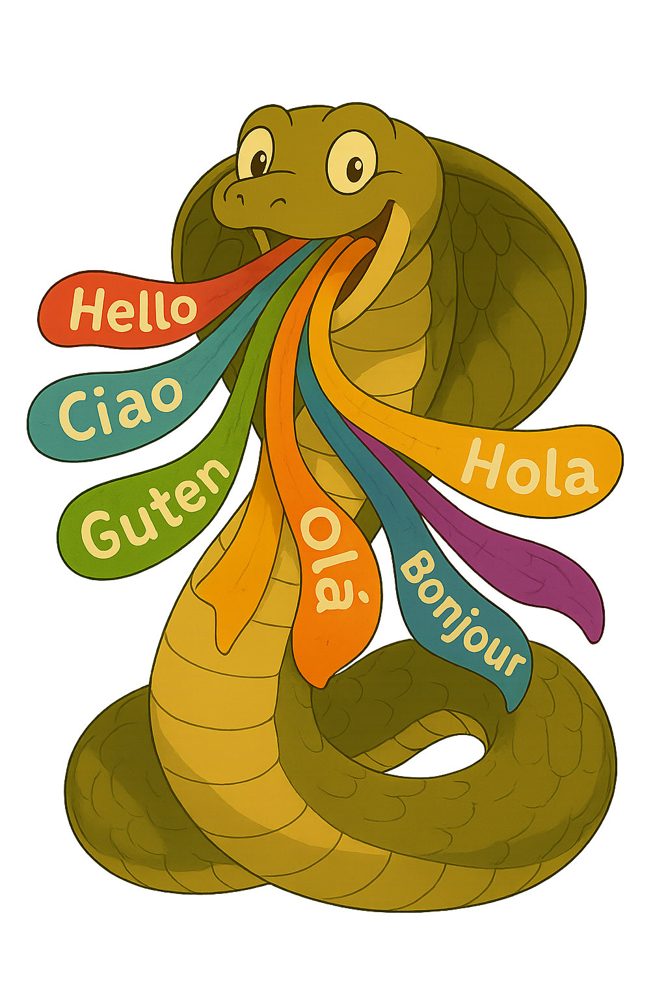

<div align="center">

<h1>MLMA: From Mono to MultiLingual ASR with MAmba-Based Architecture</h1>
<p><b>The first Mamba-based multilingual ASR system trained at scale: 11,840 hours, six European languages.</b></p>
<p>
<a href="paper/MLMA_Signal_Processing_Open.pdf"></a>
<a href="https://huggingface.co/SpeechTek"></a>
<a href="#-prerequisites"></a>
<a href="#-prerequisites"></a>
<a href="https://speechbrain.github.io"></a>
</p>
<p>
<a href="#-highlights"><b>Highlights</b></a> ·
<a href="#-architecture"><b>Architecture</b></a> ·
<a href="#-prerequisites"><b>Prerequisites</b></a> ·
<a href="#-training"><b>Training</b></a> ·
<a href="#-inference-and-checkpoints"><b>Inference</b></a> ·
<a href="#-results"><b>Results</b></a> ·
<a href="#-citation"><b>Citation</b></a>
</p>
</div>

---

## 📖 Description

This repository contains the official implementation of **MLMA** (**M**ulti**L**ingual ASR based on **MA**mba), described in our paper *"MLMA: From Mono to MultiLingual ASR with MAmba-Based Architecture"* (Mohamed Nabih Ali, Daniele Falavigna, Alessio Brutti; Fondazione Bruno Kessler, Trento, Italy). The manuscript is a preprint submitted to Elsevier.

Transformer and Conformer encoders dominate multilingual ASR, but their quadratic attention makes long speech sequences expensive in both time and memory. MLMA replaces attention with the **Mamba selective state-space model** inside a ConMamba encoder trained with CTC. It reaches competitive accuracy against a matched Conformer baseline while scaling far better to long audio.

## ✨ Highlights

- 🐍 **First multilingual Mamba-based ASR.** MLMA extends ConMamba from monolingual settings to a single shared model for **English, Italian, French, Spanish, German and Dutch**.
- 📚 **Large scale.** Trained on **11,840 hours** of speech from LibriSpeech, Common Voice v20.0, VoxPopuli-ASR and Multilingual LibriSpeech, well beyond the scale of earlier Mamba-ASR studies.
- 🎯 **Competitive accuracy.** MLMA beats a size-matched CTC-Conformer (31.6M vs. 28.8M parameters) on nearly all languages and datasets, and on the unseen FLEURS benchmark.
- ⚡ **Long-context efficiency.** For audio up to 256 s, encoder inference time grows **3.0×** (25 → 75 ms) versus **26.7×** (23 → 608 ms) for the Conformer. Encoder peak memory stays **below 500 MB**, while the Conformer exceeds **14 GB**.
- 🔓 **Open.** Code, training recipes and pretrained models are publicly released.

## 🧩 Architecture

MLMA uses a convolutional front-end, a ConMamba encoder and a CTC head over a shared multilingual character vocabulary. Each encoder block keeps the Conformer's macaron structure but replaces multi-head self-attention with a **bidirectional Mamba (Bi-Mamba)** module.


| Component | Setting |
|---|---|
| Input features | 80-dim log-Mel filterbanks (25 ms window, 10 ms shift), utterance-level mean/variance normalization |
| Front-end | Two-block CNN with temporal downsampling |
| Encoder | 18 ConMamba layers, hidden dim 256, FFN dim 1024, dropout 0.1, GELU |
| Bi-Mamba | `d_state = 16`, `expand = 2`, `d_conv = 4` |
| Output | Linear + LogSoftmax over a shared multilingual character vocabulary |
| Loss | CTC |
| Parameters | 31.6M (Conformer baseline: 28.8M) |

## 🛠 Prerequisites

1. **Prepare the data.** MLMA is trained on five public corpora. FLEURS is used for evaluation only.

   | Corpus | Link |
   |---|---|
   | LibriSpeech (clean subsets) | [OpenSLR 12](https://www.openslr.org/12) |
   | Common Voice v20.0 | [Mozilla Common Voice](https://commonvoice.mozilla.org) |
   | VoxPopuli-ASR | [facebookresearch/voxpopuli](https://github.com/facebookresearch/voxpopuli) |
   | Multilingual LibriSpeech (MLS) | [OpenSLR 94](https://www.openslr.org/94) |
   | FLEURS (evaluation only) | [google/fleurs](https://huggingface.co/datasets/google/fleurs) |

2. **Install packages.**

   ```bash
   docker build -f Dockerfile_mamba -t mamba_stek .
   ```

   You may need lower or higher versions of `torch`, `torchaudio`, `causal-conv1d` and `mamba-ssm` depending on your hardware and system. Make sure they are compatible with each other.

## 🚀 Training

Training follows the [SpeechBrain](https://speechbrain.github.io) recipe style, and the encoder builds on [ConMamba](https://github.com/xi-j/Mamba-ASR).

To train a monolingual (English) MLMA encoder with a character-level CTC loss on one GPU:

```bash
python train_CTC.py hparams/CTC/mono.yaml --data_folder <YOUR_PATH_TO_CORPORA> 
```

To train the bilingual (English + Italian) model on one GPU:

```bash
python train_CTC.py hparams/CTC/mlma_en_it.yaml 
```

To train the full multilingual MLMA (six languages, 11,840 h) on four GPUs:

```bash
torchrun --nproc-per-node 4 train_CTC.py hparams/CTC/mlma_multilingual.yaml 
```

## 🔍 Inference and Checkpoints

Pretrained checkpoints are available on 🤗 Hugging Face: **[huggingface.co/SpeechTek](https://huggingface.co/SpeechTek)**.

To evaluate a trained model on a test set:

```bash
python train_CTC.py hparams/CTC/mlma_multilingual.yaml --data_folder <YOUR_PATH_TO_DATA> --test_only --pretrained_path <PATH_TO_CHECKPOINT>
```

## 📊 Results

### Monolingual: MLMA vs. CTC-Conformer (LibriSpeech-960h, trained from scratch)

| Model | #Params (M) | test-clean WER ↓ | test-other WER ↓ |
|---|:---:|:---:|:---:|
| Conformer | 28.8 | 4.27 | 11.29 |
| **MLMA** | 31.6 | **4.05** | **10.50** |

### Multilingual: WER (%) ↓ of a single model trained on 11,840 h

FLEURS is **not** used in training and measures zero-shot generalization.

| Model | LS | CV EN | CV IT | CV FR | CV ES | CV DE | CV NL |
|---|:---:|:---:|:---:|:---:|:---:|:---:|:---:|
| Conformer | 8.7 | 24.7 | 16.8 | 17.8 | 14.2 | 15.9 | 18.9 |
| **MLMA** | **7.2** | **23.2** | **13.0** | **15.0** | **11.2** | **12.9** | **16.8** |

| Model | VP EN | VP IT | VP FR | VP ES | VP DE | VP NL |
|---|:---:|:---:|:---:|:---:|:---:|:---:|
| Conformer | 12.7 | **23.6** | 15.9 | 13.5 | 17.7 | 23.1 |
| **MLMA** | **11.5** | 24.5 | **14.8** | **12.9** | **16.1** | **21.5** |

| Model | MLS IT | MLS FR | MLS ES | MLS DE | MLS NL |
|---|:---:|:---:|:---:|:---:|:---:|
| Conformer | 14.8 | 10.7 | 7.3 | 10.6 | 17.3 |
| **MLMA** | **13.3** | **9.1** | **6.5** | **9.5** | **14.8** |

| Model | FL EN | FL IT | FL FR | FL ES | FL DE | FL NL |
|---|:---:|:---:|:---:|:---:|:---:|:---:|
| Conformer | 21.6 | 14.8 | 21.1 | 12.6 | 18.2 | 30.6 |
| **MLMA** | **19.2** | **12.5** | **19.6** | **10.6** | **15.4** | **27.9** |

> The VoxPopuli Italian subset contains many transcription errors, which may affect results there.

### Comparison with large multilingual foundation models (WER % ↓)

The reference systems differ widely in architecture, size, training data and decoding, so they are included as references rather than direct baselines. MLMA uses 31.6M parameters and 11.8K hours.

| Model | MLS IT | MLS FR | MLS ES | MLS DE | MLS NL | FLEURS EN |
|---|:---:|:---:|:---:|:---:|:---:|:---:|
| Whisper-small | 21.3 | 13.6 | 9.1 | 11.5 | 18.2 | 9.6 |
| Whisper-medium | 15.6 | 9.7 | 6.1 | 8.1 | 12.2 | 6.4 |
| OWSM v3.1-medium | 20.2 | 12.1 | 9.0 | 10.8 | 18.1 | 9.0 |
| OWSM-CTC | 22.1 | 12.9 | 10.3 | 11.9 | 20.4 | 9.9 |
| **MLMA (ours)** | 13.3 | 9.1 | 6.5 | 9.5 | 14.8 | 19.2 |

MLMA beats OWSM-CTC in every language and OWSM v3.1 on MLS, and matches or surpasses Whisper-small on French, Spanish, German and Dutch. Its higher FLEURS WER is expected: FLEURS is fully out-of-domain for MLMA, while the larger systems were likely trained on it.

### ⚡ Computational efficiency (encoder, 5 s → 256 s inputs)

| Metric | MLMA | CTC-Conformer |
|---|:---:|:---:|
| Inference time | 25 → 75 ms (**3.0×** growth) | 23 → 608 ms (**26.7×** growth) |
| Peak encoder memory at 256 s | **< 500 MB** | **> 14 GB** |

For utterances under about 40 s, both architectures perform comparably. The gap opens for long-form audio.

### 📈 Scaling

- **Model capacity** (Common Voice): going from 31.6M to 42.0M parameters lowers WER from 23.00 → 21.04 (EN) and 10.92 → 10.42 (IT).
- **Training data** (English): going from 460 h to 2,760 h lowers WER from 5.3 → 3.6 (LibriSpeech), 56.5 → 18.8 (Common Voice), 32.8 → 10.7 (VoxPopuli) and 35.4 → 14.9 (FLEURS).

## 🗂 Training data

| Language | Hours | Share |
|---|:---:|:---:|
| 🇩🇪 German | 3,178 | 27% |
| 🇬🇧 English | 2,760 | 23% |
| 🇫🇷 French | 2,112 | 18% |
| 🇳🇱 Dutch | 1,646 | 14% |
| 🇪🇸 Spanish | 1,569 | 13% |
| 🇮🇹 Italian | 574 | 5% |
| **Total** | **11,840** | |

## 🔭 Future work

Scaling to a broader and more diverse set of languages, integrating self-supervised multilingual representations, and extending the framework to streaming ASR and code-switching.

## 🙏 Acknowledgements

- We build on [Mamba](https://github.com/state-spaces/mamba), [Vision Mamba](https://github.com/hustvl/Vim) (bidirectional Mamba) and [ConMamba / Mamba-ASR](https://github.com/xi-j/Mamba-ASR). Training recipes are adapted from [SpeechBrain](https://speechbrain.github.io).
- This work was supported by the Ministero delle Imprese e del Made in Italy (IPCEI Cloud DM 27 giugno 2022, IPCEI-CL-0000007) and the European Union (Next Generation EU).
- This project is co-funded by the Digital Europe Programme under Grant Agreement No 101198470. Views and opinions expressed are those of the authors only and do not necessarily reflect those of the European Union or the European Commission. Neither the European Union nor the granting authority can be held responsible for them.

## 📝 Citation

If you find this work helpful, please consider citing:

```bibtex
@article{ali2026mlma,
  title   = {MLMA: From Mono to MultiLingual ASR with MAmba-Based Architecture},
  author  = {Ali, Mohamed Nabih and Falavigna, Daniele and Brutti, Alessio},
  journal = {Preprint submitted to Elsevier},
  year    = {2026}
}
```

## 📬 Contact

**Mohamed Nabih Ali** ([mnabih@fbk.eu](mailto:mnabih@fbk.eu)) · **Daniele Falavigna** ([falavi@fbk.eu](mailto:falavi@fbk.eu)) · **Alessio Brutti** ([brutti@fbk.eu](mailto:brutti@fbk.eu))

Center of Augmented Intelligence, [Fondazione Bruno Kessler](https://www.fbk.eu), Trento, Italy.

You may also like [ConMamba for ASR](https://github.com/xi-j/Mamba-ASR).
